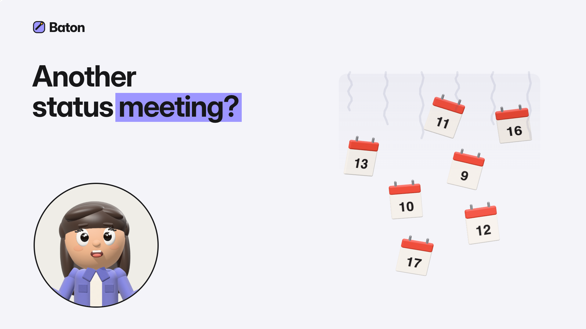
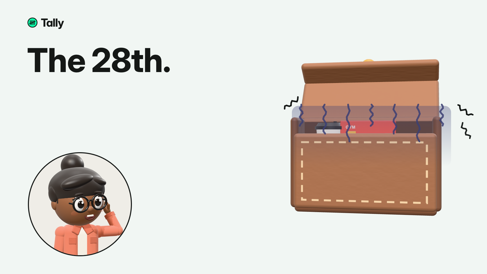
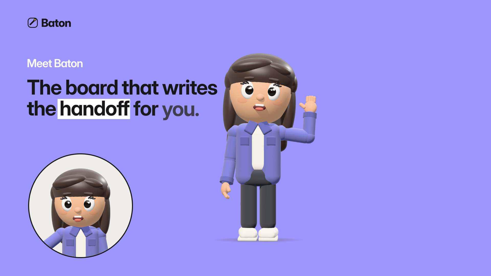
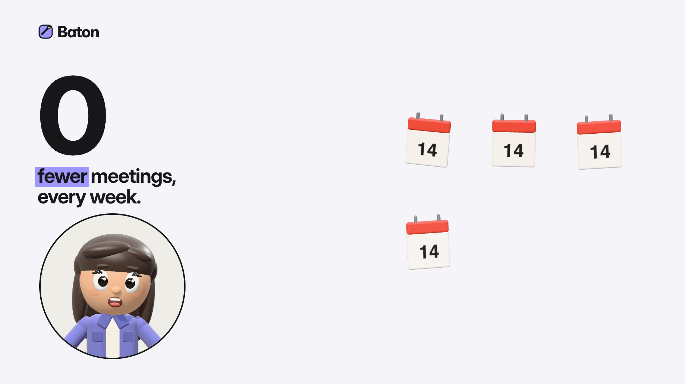
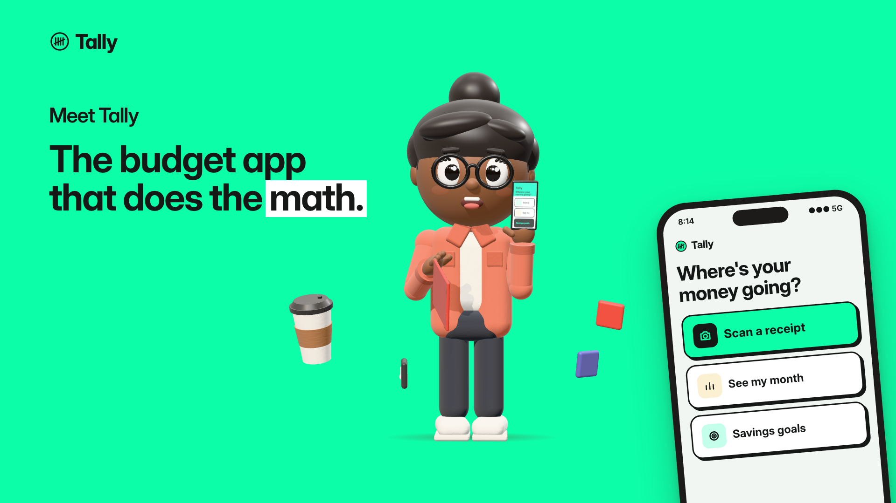
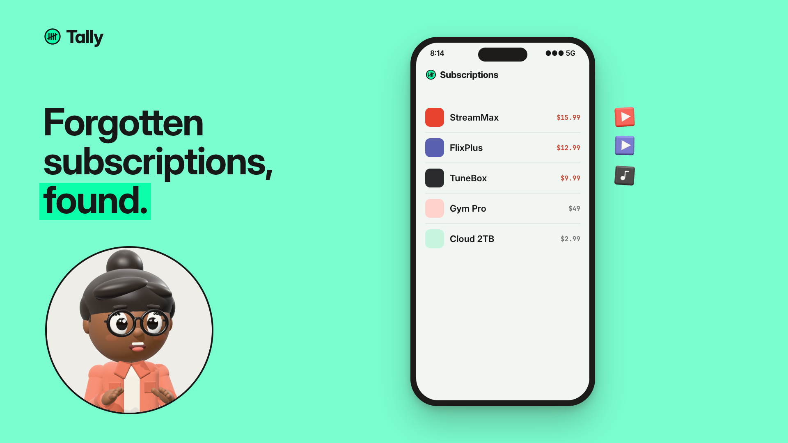
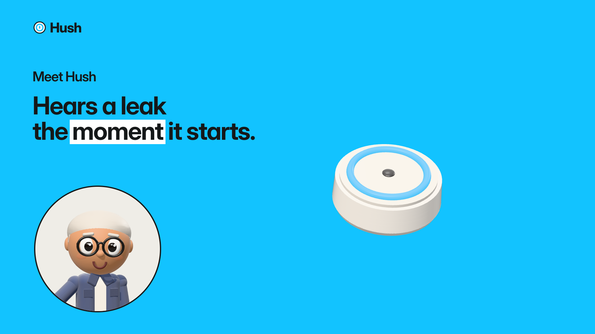
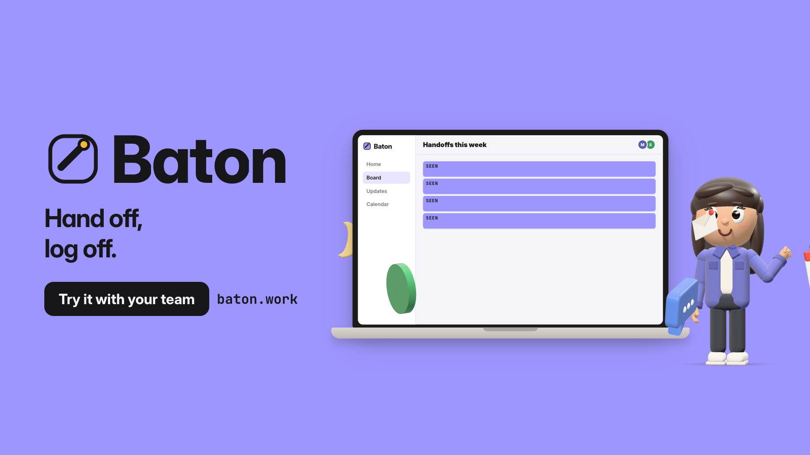
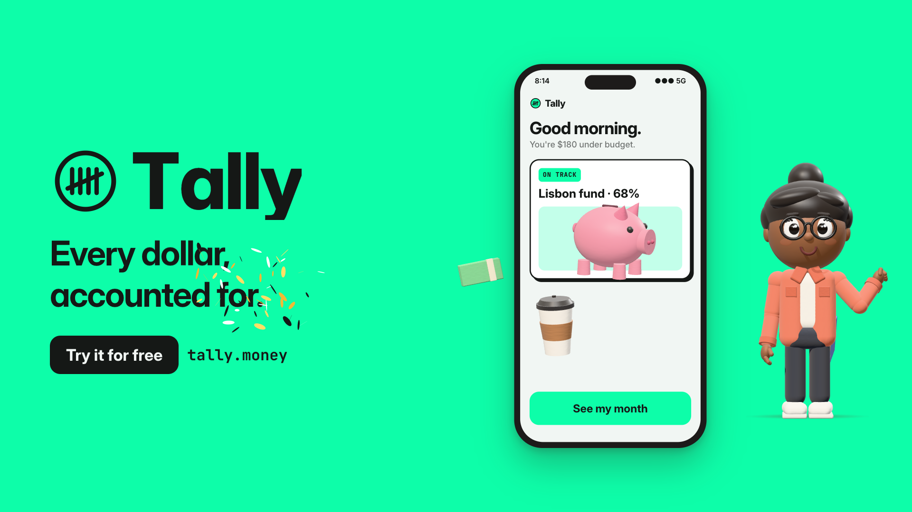
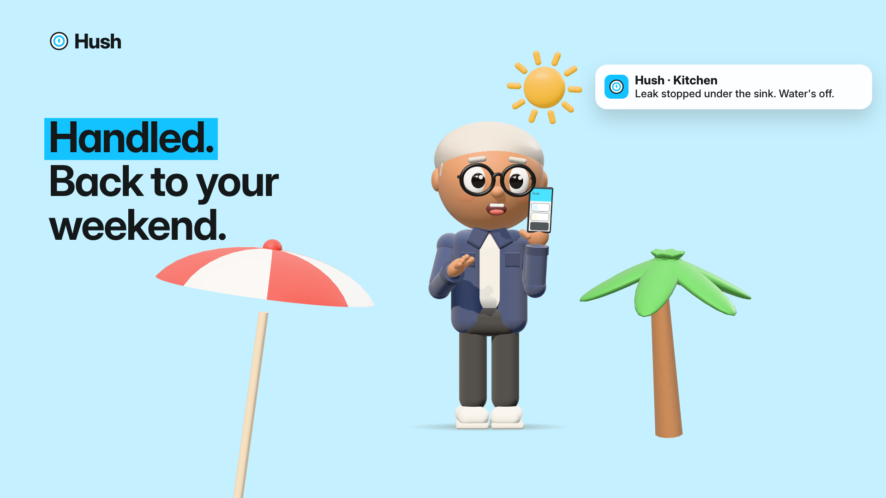

# Clay Motion Graphics

A **Claude Code plugin** that turns a sentence about your product into a finished
30–35 second motion-graphics film: 3D clay mascot and props, your product as the hero,
voiceover, composed music and sound effects, rendered to MP4.

Claude writes **every frame** as HTML/SVG/Three.js. A free, local toolchain captures and
encodes it. No paid libraries, no stock assets, no AI image/video/voice services, nothing
sent to a server.

The **style is fixed; the story is invented per product.** Claude works out what your
product is worth to the viewer, picks a story shape (problem → solution, connection,
peace of mind, before/after…), composes the film from a scene library, and writes the app
screens itself. You never supply screenshots.

---

## Example films

Rendered entirely by this skill. **Click a frame to play the film.**

| | |
|:--:|:--:|
| [](media/baton.mp4) | [](media/tally.mp4) |
| **Baton** — project board for remote teams<br>web app on a laptop, two characters<br>[▶ play (8 MB)](media/baton.mp4) | **Tally** — budgeting app<br>phone app, stat scenes<br>[▶ play (10 MB)](media/tally.mp4) |

### Frames from the same three films

| Baton | | Tally | | Hush |
|:--:|:--:|:--:|:--:|:--:|
|  |  |  |  |  |
|  | |  | |  |

**Hush** is a physical product (a smart leak sensor) rather than an app — the same style
handles hardware, phone apps and web apps.

---

## Install

**One command**, from inside a Claude Code session (requires Claude Code v2.1.275+):

```
/plugin install clay-motion-graphics-template --marketplace teddpop/clay-motion-graphics-template
```

<details>
<summary>Or two commands in your shell (works on any version)</summary>

```bash
claude plugin marketplace add teddpop/clay-motion-graphics-template
claude plugin install clay-motion-graphics-template@teddpop-plugins
```

The first command registers this repository as a plugin marketplace — a catalog Claude Code
can read. It installs nothing. The second installs the plugin from that catalog. The
`@teddpop-plugins` suffix is the marketplace's name, not the repository's.

</details>

<details>
<summary>Or use it as a plain skill, without the plugin system</summary>

Copy `skills/motion-graphics/` into a project's `.claude/skills/`, or into `~/.claude/skills/`
to have it in every project.

</details>

## One-time setup

The renderer needs a local toolchain and about 860 MB of models. The easiest way is to let
Claude do it — in a session, after installing, just ask:

> set up the motion graphics toolchain

Or run it yourself. Installed as a plugin, the script lives in the marketplace checkout:

```bash
bash ~/.claude/plugins/marketplaces/teddpop-plugins/skills/motion-graphics/engine/setup.sh
```

It installs or downloads everything and prints a status table:

- ffmpeg, whisper-cpp and fluid-synth (via Homebrew on macOS; prints `apt` hints elsewhere)
- Three.js r170 (already vendored in this repo)
- a Python 3.12 venv with Kokoro TTS, via `uv` — your system Python is untouched
- the Kokoro voice model (~340 MB), whisper `small.en` (~490 MB), GeneralUser GS soundfont (~32 MB)
- `playwright-core`

**Requirements:** Google Chrome, Node 18+, python3, curl.

### Platform support

| Platform | Status |
|---|---|
| **macOS** (Apple Silicon) | **Supported.** `setup.sh` installs system tools via Homebrew; hardware Metal WebGL. A 35 s render takes 30–60 s. |
| **Linux** | Should work, **untested.** `setup.sh` prints `apt install` hints rather than installing. Software WebGL (SwiftShader) is slower. |
| **Windows** | **Not supported.** `setup.sh` has no Windows branch — it installs nothing, and its Chrome check looks for a `google-chrome` binary that doesn't exist on Windows. Use **WSL2** and follow the Linux notes. |

Pull requests adding a Windows or Linux branch to `engine/setup.sh` are welcome.

## Use it

There is **no command to run.** Once installed, the skill loads itself whenever you ask
Claude for a video:

> Make me a 30-second promo for my meal-planning app

Claude then:

1. **Interviews you once** — value, audience and moment, story shape and hero, look and
   voice. Answer, or say "you decide" to any of it.
2. **Writes `projects/<slug>/video.json`** — story, script, scenes, screens, cast — and
   shows you an approval package before rendering.
3. **Renders** voiceover → music → review stills → `projects/<slug>/out/<slug>.mp4`

<details>
<summary>Manual commands, if you'd rather drive it yourself</summary>

Run these from your working directory, with `<skill-dir>` being the installed skill's folder:

```bash
node <skill-dir>/engine/new-project.mjs my-film --from hush        # scaffold from an example
node <skill-dir>/engine/vo.mjs projects/my-film                    # voiceover + word timings
node <skill-dir>/engine/build.mjs projects/my-film --skip-vo --stills 2,6,10   # review frames
node <skill-dir>/engine/build.mjs projects/my-film --skip-vo --skip-music      # final MP4
```

</details>

## What's in here

```
.claude-plugin/
  plugin.json               plugin manifest
  marketplace.json          marketplace catalog (one entry, source "./")
media/                      the example films and frames shown above
skills/motion-graphics/
  SKILL.md                  the workflow Claude follows
  styles/clay-story.md      the house style: look, layout, motion, timing, sound
  references/               story.md, scenes.md, director.md, scriptwriting.md, clay-props.md
  examples/                 pantrio / baton / hush video.json — format references
  engine/
    style/clay-story/       style layer: captions, cast, hero device, wipes, ending rules
    scenes/                 scene library: statement, problem-object, clutter, duo, idea,
                            product-hero, device, vignette, shield, stat, end
    screens/                phone (15 types) + desktop (4 types) UI kits, written from copy
    props/                  clay prop packs: food, finance, office, fitness, home, ui
    host3d.js clay3d.js …   mascot, 3D stage, runtime, renderer, VO, music, mix
    test/                   preview pages for props, screens, mascot looks and poses
```

**Never** add Remotion, GSAP, Lottie/After Effects tooling, stock media, paid fonts, or AI
image/video/voice APIs — the skill is built to avoid all of them, and the style depends on it.

## Licence

MIT — see [`LICENSE`](LICENSE). Third-party components and their licences are listed in
[`THIRD_PARTY_NOTICES.md`](THIRD_PARTY_NOTICES.md).
